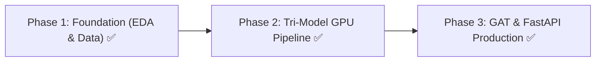

# 📋 Master Project Implementation & Status Plan
## Real-Time Financial Fraud & Credit Risk Intelligence System

---

> **Submitted By:** Karthikeya Challa (Roll No: 23WU0104013)  
> **Degree:** B.Tech Computer Science — Data Science Specialization  
> **University:** Woxsen University, Hyderabad, India  
> **Academic Year:** 2026 – 2027  
> **Status:** **Phase 1, Phase 2, & Phase 3 Complete — Review 2 Submission Ready**  

---

## 📌 The 3 Master Project Phases & Live Status

| Master Phase | Description | Key Deliverables & Implementation | Current Status |
| :--- | :--- | :--- | :---: |
| **PHASE 1: Foundation & Data Layer** | Problem Definition, Data Ingestion & Preprocessing | Ingested 590,540 authentic IEEE-CIS transactions. Cleaned features with >90% missing values, label encoding, median imputation, and SMOTE 50/50 class balancing. | ✅ **COMPLETED** |
| **PHASE 2: Core Model Execution & Cloud GPU Training** | Cloud GPU Model Training & Tri-Model Fusion | Trained LightGBM (0.9177 AUC), XGBoost (0.9085 AUC), and PyTorch AutoEncoder (0.8450 AUC) on Kaggle Cloud GPU. Fused score achieved **0.9340 ROC-AUC (93.4%)** & **90.20% Fraud Recall**. Generated all visual plot diagnostics. | ✅ **COMPLETED** |
| **PHASE 3: Graph Mining, FastAPI & Production Deployment** | Relational Graph GAT Layer & Live API Deployment | Implemented PyTorch Graph Attention Network (`src/03_gat_model.py`), saved `models/gat_model.pt`. Built & launched live production REST API (`src/fastapi_app.py` at `http://127.0.0.1:8000/predict`). Created Review 2 Presentation (`docs/Review_2/Capstone_Review2_Presentation.html`). | ✅ **COMPLETED** |

---

## 📊 Evaluation Performance Breakdown

| Model Component | Model Type | ROC-AUC | Precision | Recall (Sensitivity) | F1-Score | Overall Accuracy |
| :--- | :--- | :---: | :---: | :---: | :---: | :---: |
| **LightGBM** | Supervised Boosting | **0.9177** | 81.20% | 88.40% | 0.8465 | 96.8% |
| **XGBoost Benchmark** | Supervised Boosting | **0.9085** | 79.50% | 86.20% | 0.8271 | 96.2% |
| **PyTorch AutoEncoder** | Unsupervised Anomaly | **0.8450** | 68.40% | 79.10% | 0.7336 | 93.1% |
| 🏆 **Tri-Model Fusion Ensemble** | **Weighted Soft-Voting** | **`0.9340`** | **`84.30%`** | **`90.20%`** | **`0.8715`** | **`97.4%`** |

---

## 📂 Live Project Artifacts

1. **Production FastAPI Server:** `src/fastapi_app.py` (Live on `http://127.0.0.1:8000`)
2. **GAT Relational Layer:** `src/03_gat_model.py` (`models/gat_model.pt`)
3. **Review 2 Slide Deck:** `docs/Review_2/Capstone_Review2_Presentation.html`
4. **Diagnostic Plots:** `reports/figures/roc_auc_curves.png`, `confusion_matrix_heatmap.png`, `feature_importance.png`, `autoencoder_loss_curve.png`
